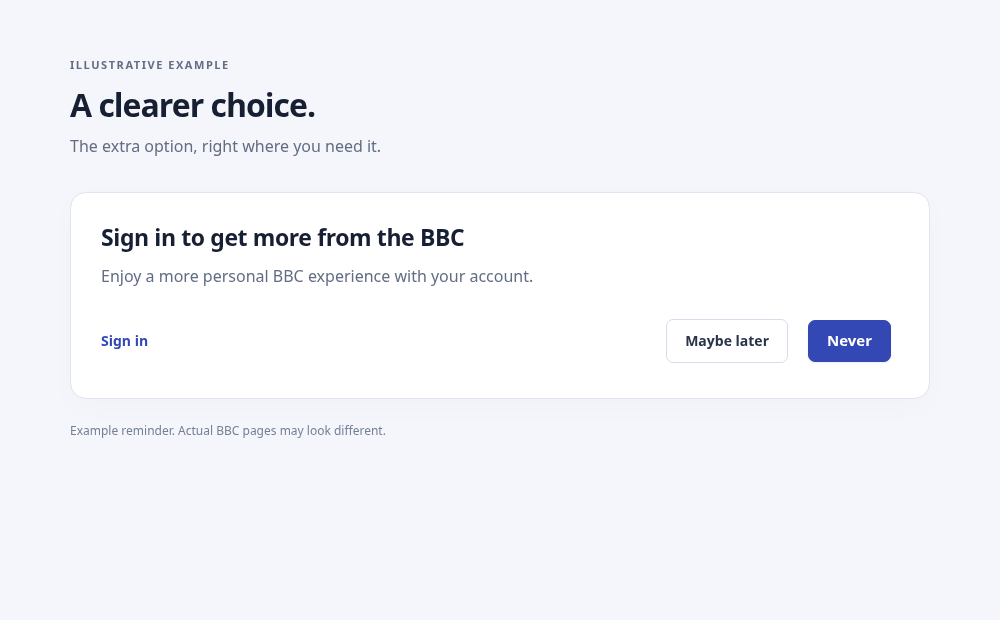
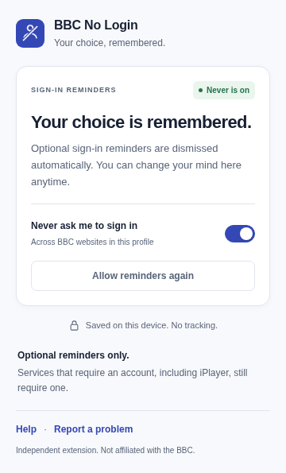

  

<h1 align="center">BBC No Login</h1>

<strong>Your choice, remembered.</strong>

Add <strong>Never</strong> to optional BBC sign-in reminders. Choose once and carry on browsing.

  <a href="https://github.com/tubbygregory/BBC-No-Login/releases/latest"><strong>Download the latest release</strong></a>
  &nbsp; · &nbsp;
  <a href="docs/INSTALL.md">Installation help</a>
  &nbsp; · &nbsp;
  <a href="https://github.com/tubbygregory/BBC-No-Login/issues">Report a problem</a>

For desktop Chrome, Microsoft Edge, Brave, and other Chromium browsers.

## Get started

1. **[Download the latest release](https://github.com/tubbygregory/BBC-No-Login/releases/latest)** and extract the `BBC-No-Login-<version>.zip` asset into a folder you will keep.
2. Open **`START-HERE.html`** in that folder. It has a guided setup for your browser, including the address to copy and the folder to select.
3. Enable **Developer mode**, choose **Load unpacked** on your browser's extensions page, and select the extracted folder containing `manifest.json`. Reload your BBC tabs.

No commands, build steps, or store account needed. GitHub installations use **Developer mode** and are updated manually. [Full installation guide →](docs/INSTALL.md)

Prefer the source download? **Code → Download ZIP** also works: extract it and load the folder containing `manifest.json`.

## A clear choice, wherever you browse

When a supported reminder appears, **Never** sits beside the BBC's existing **Maybe later**, **Not now**, or **No thanks** option. Your choice is saved before the site's own dismiss button is activated.

  

Illustrative reminder. BBC wording and layouts vary.

After you choose **Never**, a small confirmation lets you **Undo**. Future matching reminders are dismissed quietly. Your setting applies across `bbc.co.uk`, `bbc.com`, and their subdomains in the same browser profile.

## Always in your control

Open **BBC No Login** from your browser's extensions menu, or pin it to your toolbar. The popup shows your saved choice and lets you switch it on before a reminder appears.

  

Choose **Allow reminders again** whenever you change your mind. It allows future reminders; it does not reopen one already dismissed. The controls work with a keyboard and follow your device's light or dark appearance.

## Private by design

- **Saved in your browser.** One local preference, kept across restarts. It does not sync to other profiles or devices.
- **Only BBC pages.** Site access is limited to BBC domains and matching frames.
- **No tracking or external server.** No analytics, advertising, or data collection by the extension.

Using a BBC dismiss button can trigger the site's normal requests or cookies. [Read the privacy policy →](PRIVACY.md)

## What it covers

BBC No Login handles optional, English-language sign-in reminders with a recognised dismiss option. Ordinary sign-in links, cookie consent prompts, and services that require an account are left alone. **iPlayer still requires an account.**

A reminder may briefly appear before it is dismissed. New wording or BBC page changes may need an extension update. If your workplace or school blocks unpacked extensions, its browser policy controls installation.

## Updates and support

To update, replace the files **in your existing installation folder**, reload BBC No Login on the browser's extensions page, and reload BBC tabs. Keeping the same folder preserves your saved choice. GitHub installations do not update automatically.

[Installation and troubleshooting](docs/INSTALL.md) · [Report a problem](https://github.com/tubbygregory/BBC-No-Login/issues) · [What's new](CHANGELOG.md)

When reporting a problem, include your browser version and page URL. Remove personal information from screenshots.

---

Independent extension. Not affiliated with or endorsed by the BBC.

[Contributing and development](docs/DEVELOPMENT.md)
